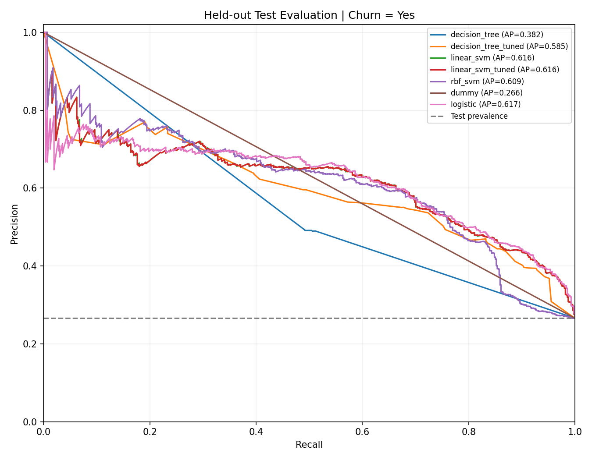

# Telco Customer Churn Prediction

2025년 3학년 1학기 기계학습 과목에서 수행한 3인 팀 프로젝트입니다. IBM Telco Customer Churn 데이터로 고객의 이탈 여부를 분류했습니다. 저는 Decision Tree와 SVM의 구현, 하이퍼파라미터 탐색, 평가를 맡았고, 현재 공개된 실험에서는 전처리와 특성 선택을 각 교차검증 훈련 폴드 안에서 학습하도록 구성했습니다.

[테스트 지표](results/metrics.json) · [교차검증 기록](results/cv_search_results.csv) · [선택 특성](results/selected_features.json) · [실행 안내](RUNBOOK.md)

## Test Results

같은 테스트셋 2,110행에서 이탈(`Churn=Yes`)을 양성으로 평가했습니다. Decision Tree의 AP는 튜닝 후 **0.3815에서 0.5849**로 올랐고, 최고 AP는 로지스틱 회귀의 **0.6172**였습니다. 이 비교에는 입력 특성 구성도 반영됩니다. 두 비교 모델은 전처리된 특성 46개를, 트리와 SVM은 RFE로 선택한 특성 20개를 사용했습니다.

| 모델 | 입력 특성 | 정확도 | 정밀도 | 재현율 | F1 | ROC-AUC | AP |
| --- | ---: | ---: | ---: | ---: | ---: | ---: | ---: |
| 최빈 클래스 (`DummyClassifier`) | 46 | 0.7341 | 0.0000 | 0.0000 | 0.0000 | 0.5000 | 0.2659 |
| 로지스틱 회귀 | 46 | **0.8057** | **0.6557** | **0.5668** | **0.6080** | **0.8379** | **0.6172** |
| Decision Tree | 20 | 0.7294 | 0.4911 | 0.4920 | 0.4915 | 0.6597 | 0.3815 |
| 튜닝한 Decision Tree | 20 | 0.7758 | 0.5957 | 0.4884 | 0.5367 | 0.8082 | 0.5849 |
| RBF SVM | 20 | 0.7872 | 0.6514 | 0.4296 | 0.5177 | 0.7894 | 0.6091 |
| LinearSVC | 20 | 0.8009 | 0.6503 | 0.5437 | 0.5922 | 0.8335 | 0.6161 |
| 튜닝한 LinearSVC | 20 | 0.8009 | 0.6503 | 0.5437 | 0.5922 | 0.8335 | 0.6161 |

- 최빈 클래스 모델은 모두 비이탈로 분류했습니다. 정확도는 73.41%였고, 이탈 561건 가운데 검출한 건은 0건이었습니다.
- Decision Tree 튜닝으로 오탐은 286건에서 186건으로 줄고 정밀도와 F1이 높아졌습니다. 이탈 검출은 276건에서 274건으로 줄어 재현율이 소폭 하락했습니다.
- 기본·튜닝 LinearSVC는 각각 305건의 이탈을 검출했고 혼동행렬도 같았습니다. 소수점 여섯 자리까지 표시하면 AP는 각각 **0.616120**, **0.616090**입니다.

AP(Average Precision)는 전체 예측 점수로 계산합니다. 로지스틱 회귀와 두 종류의 SVM은 `decision_function()` 점수를, Decision Tree와 최빈 클래스 모델은 `predict_proba()`의 양성 열을 사용합니다. 정확도·정밀도·재현율·F1은 각 모델의 기본 `predict()` 판정으로 계산했습니다. [AP 계산식](https://scikit-learn.org/stable/modules/generated/sklearn.metrics.average_precision_score.html)

회색 점선은 테스트셋의 실제 이탈 비율(26.59%)입니다. [ROC 곡선](results/figures/roc_comparison.png) · [튜닝 트리 혼동행렬](results/figures/confusion_matrix_dt.png) · [튜닝 LinearSVC 혼동행렬](results/figures/confusion_matrix_svm.png)

## Evaluation Design

IBM 원본 7,043행 중 `TotalCharges`를 숫자로 변환할 수 없는 11행을 제외했습니다. 남은 7,032행에는 이탈 1,869행, 비이탈 5,163행이 있습니다. `customerID`는 행 검증에 사용하고 입력에서 제외했습니다. [IBM 원본 CSV](https://github.com/IBM/telco-customer-churn-on-icp4d/blob/1fd6fd70906479be1712e64cfc0ea89f58466629/data/Telco-Customer-Churn.csv)

1. 시드 `42`로 층화 무작위 분할해 훈련 4,922행과 테스트 2,110행을 확보했습니다.
2. 트리와 LinearSVC의 설정은 훈련 데이터에서 층화 5겹 교차검증으로 탐색했습니다. 각 훈련 폴드에서 `tenure`, `MonthlyCharges`, `TotalCharges`를 표준화하는 `StandardScaler`와 `SeniorCitizen` 등 범주형 변수 16개를 변환하는 `OneHotEncoder(handle_unknown="ignore")`를 학습했습니다.
3. 각 훈련 폴드 안에서 로지스틱 회귀 기반 RFE(재귀적 특성 제거)로 변환 후 특성 20개를 선택했습니다. 교차검증 평균 AP가 가장 높은 설정의 전처리, RFE, 분류기를 훈련셋 전체에서 다시 학습했습니다.
4. 기본 모델도 훈련셋 전체에서 학습했습니다. 최빈 클래스 모델과 로지스틱 회귀는 전처리된 특성 전체를 사용하고, 기본 트리와 SVM은 RFE로 20개를 선택했습니다. 학습과 설정 선택이 끝난 뒤 같은 테스트셋으로 평가했습니다.

| 탐색 대상 | 조합 수 | 선택한 설정 | 평균 검증 AP |
| --- | ---: | --- | ---: |
| Decision Tree | 72 | `criterion=entropy`, `max_depth=7`, `min_samples_split=10`, `min_samples_leaf=4` | 0.6148 |
| LinearSVC | 9 | `C=10`, `max_iter=1000`, `dual="auto"` | 0.6538 |

LinearSVC의 `C=10`에서는 세 가지 `max_iter` 값의 평균 AP가 같아 탐색 순서가 가장 앞선 `1000`이 선택됐습니다. [조합별 검증 기록](results/cv_search_results.csv)

학습에 사용한 트리와 같은 특성명으로 그림을 만들었습니다. 첫 분기는 월 단위 계약(`Contract=Month-to-month`)이며, 그림은 루트(깊이 0)부터 깊이 3까지를 펼쳐 보여줍니다. `MonthlyCharges`나 `tenure` 등 수치형 변수의 분기값은 표준화된 값입니다. [학습한 의사결정나무](results/figures/decision_tree.png)

표에 제시한 성능은 단일 데이터셋과 층화 분할에서 얻었습니다. 미래 시점의 고객으로 일반화하려면 시간 순서를 반영한 검증이 필요합니다. SVM의 점수는 이탈 위험 순위를 매기는 데 쓰이며, 고객별 확률로 사용하려면 별도의 확률 보정과 검증이 필요합니다.

## Coursework Experiments

수업 당시 저는 Decision Tree와 SVM을 구현하고 결과를 분석했습니다. 팀에서는 PCA, KNN, Bagging, Random Forest, AdaBoost, LightGBM, XGBoost, Soft Voting도 비교했습니다. 당시 AdaBoost의 ROC-AUC 약 0.847과 RBF SVM의 재현율 0은 수업 기록에 남아 있습니다. 당시 앙상블 결합은 `VotingClassifier(voting="soft")`로 구현했습니다. [2025년 팀 실험 기록](historical/historical_results.json)

수업 당시에는 시드 `0`으로 분할했고, 분할 전에 전체 데이터에서 RFE를 학습했습니다. 당시 트리·SVM의 입력을 만드는 과정에서 `tenure` 열이 빠져 19개 특성이 사용됐고, SVM에는 표준화 전 값이 전달됐습니다. 현재 평가에서는 훈련 폴드 안에서 선택한 특성 20개가 모두 모델에 전달되도록 확인합니다. 수업 결과와 현재 결과에는 각각의 분할·전처리 조건이 적용됩니다.

## Reproduction

[실행 안내](RUNBOOK.md)에서 설치, IBM 데이터 받기, 전체·부분 재실행 명령을 확인할 수 있습니다. 공개 결과는 Windows의 Python 3.11.3에서 생성했고, CI는 Linux의 Python 3.12에서 아래 검사를 실행합니다.

~~~bash
python -m unittest discover -s tests -v
python -m scripts.smoke
python -m scripts.validate_artifacts results --full
~~~

단위 테스트 16개는 데이터 정제, 폴드별 학습 범위, RFE 특성명과 입력 순서, 평가지표를 검사합니다. 합성 데이터로 기본 학습·평가 흐름을 실행하고, 저장 결과 검사로 모델 7개와 탐색 기록 81개의 정합성을 확인합니다. [CI 워크플로](.github/workflows/ci.yml)