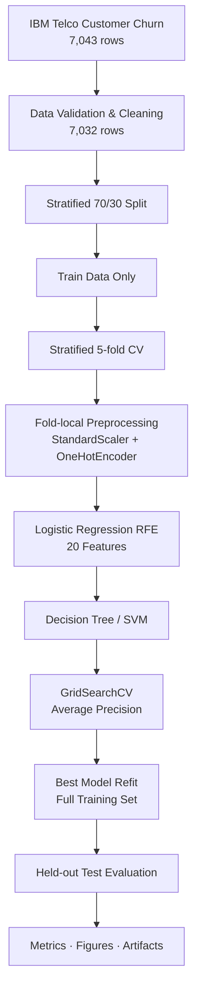
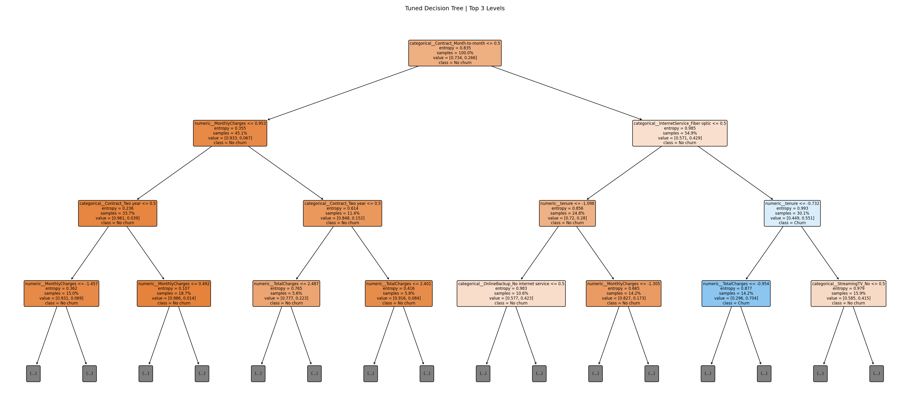
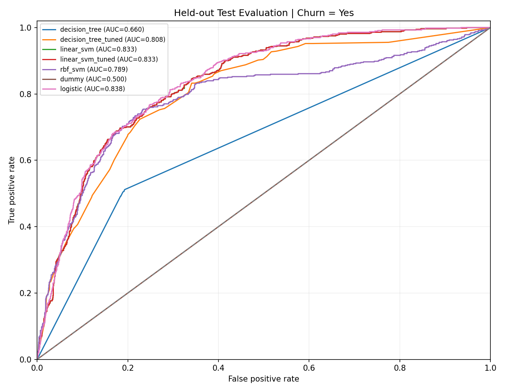
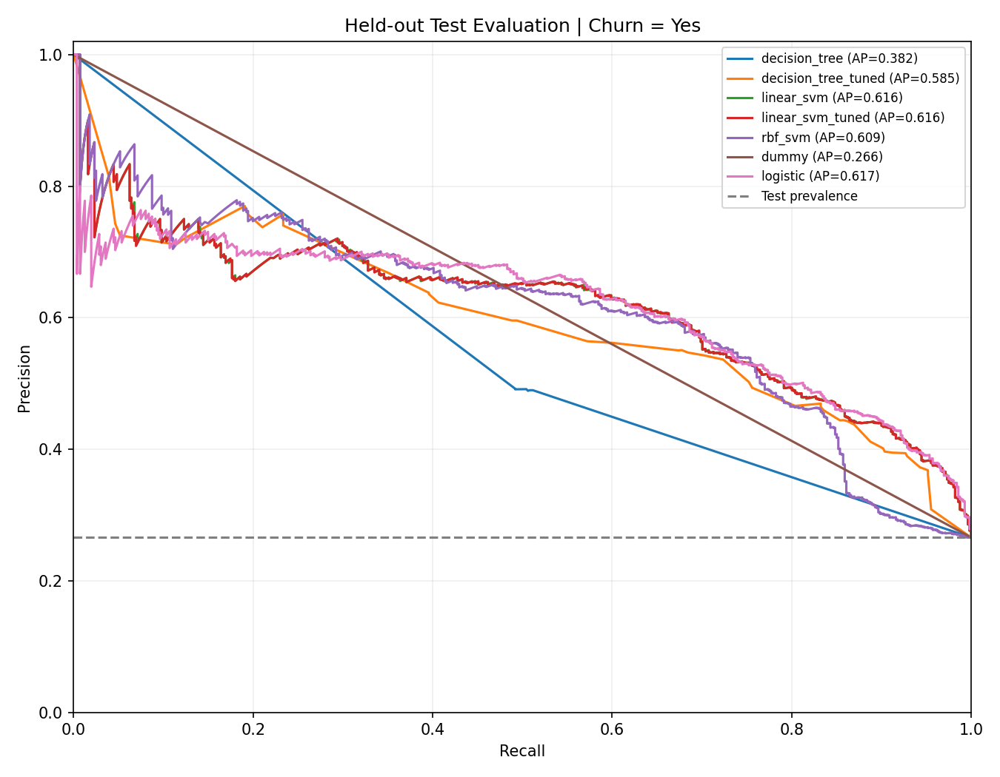
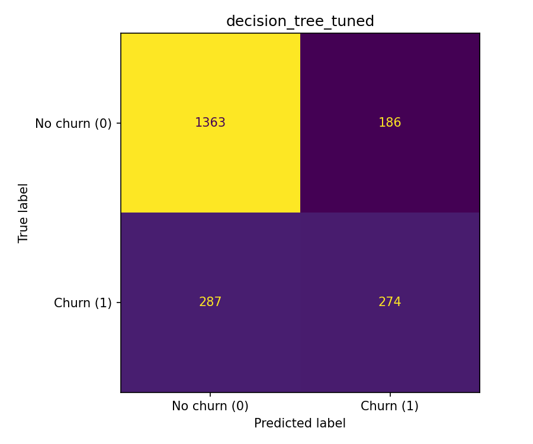
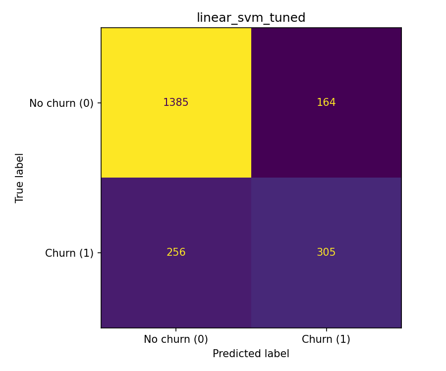

<div align="center">
    
# Telco Customer Churn Prediction

### Decision Tree · Support Vector Machine · Leakage-safe Machine Learning

**통신사 고객 이탈을 예측하기 위해 Decision Tree와 SVM을 구현·튜닝한 3인 팀 기계학습 프로젝트입니다. 특성 선택, 교차검증, 모델별 성능 비교를 수행했으며, 현재 구현은 데이터 누수를 방지하는 재현 가능한 평가 파이프라인을 제공합니다.**

<br/>


[](https://github.com/tangerineYR/telco-churn-ml/actions/workflows/ci.yml)

**[Results](results/metrics.json)** · **[CV Search](results/cv_search_results.csv)** · **[Selected Features](results/selected_features.json)** · **[Reproduction Guide](RUNBOOK.md)**

</div>

---

## 📌 Overview

본 프로젝트는 2025년 3학년 1학기 **기계학습 전공 수업에서 수행한 3인 팀 프로젝트**입니다.

IBM Telco Customer Churn 데이터를 활용해 고객 이탈 여부(`Churn: Yes / No`)를 분류하고, 특성 선택·차원 축소·다양한 분류 모델·앙상블 기법의 성능을 비교했습니다.

**직접 담당한 작업은 Decision Tree와 SVM 모델의 구현 및 평가입니다.** 기본 Decision Tree와 RBF SVM의 성능을 분석하고, GridSearchCV를 통해 Decision Tree와 LinearSVC의 하이퍼파라미터를 탐색했습니다.

초기 실험에서 발견된 전체 데이터 기반 RFE의 타깃 누수, SVM 스케일링 누락, 입력 특성 수 불일치, Decision Tree 시각화 오류를 해결했습니다. 현재 평가에서는 훈련 데이터 내부의 교차검증으로 모델을 선택하고 독립된 테스트셋으로 성능을 측정합니다.

### Project Info

| 항목 | 내용 |
|---|---|
| **프로젝트 유형** | 기계학습 전공 프로젝트 · 3인 팀 |
| **수행 시기** | 2025년 3학년 1학기 |
| **개인 담당** | Decision Tree · SVM |
| **Dataset** | IBM Telco Customer Churn |
| **Original Samples** | 7,043 |
| **Cleaned Samples** | 7,032 |
| **Prediction Target** | Churn (`Yes = 1`) |
| **Feature Selection** | Logistic Regression-based RFE |
| **Selected Features** | 20 |
| **Model Tuning** | Stratified 5-fold GridSearchCV |
| **Selection Metric** | Average Precision (AP) |
| **Final Evaluation** | Independent 30% holdout |
| **Validation** | 16 automated tests · synthetic smoke |

---

## 👤 My Contributions

### 1. Decision Tree Classification

- 기본 `DecisionTreeClassifier` 구현 및 성능 평가
- `criterion`, `max_depth`, `min_samples_split`, `min_samples_leaf`를 대상으로 **72개 하이퍼파라미터 조합 탐색**
- 5-fold GridSearchCV를 통한 모델 선택
- Decision Tree 구조 시각화 및 주요 분기 특성 분석

### 2. Support Vector Machine

- 기본 RBF SVM 학습·평가 및 이탈 고객 탐지 실패 사례 분석
- LinearSVC 대안 실험 및 성능 비교
- `C`, `max_iter`에 대한 **9개 하이퍼파라미터 조합 탐색**
- Precision, Recall, F1 등을 활용해 양성 클래스 예측 성능 분석

### 3. Team-wide Collaboration

RFE 기반 특성 선택, PCA, KNN 및 앙상블 모델 비교는 팀 단위로 진행했습니다. 개인 담당 범위는 앞서 설명한 Decision Tree와 SVM의 구현·튜닝·평가입니다.

RFE 기반 특성 선택, PCA, KNN, Bagging, Random Forest, AdaBoost, LightGBM, XGBoost, Hard/Soft Voting.

---

## 🏗️ Evaluation Pipeline

평가 파이프라인은 Stratified Train/Test Split 이후 전처리와 RFE를 각 교차검증 훈련 fold에서 학습하도록 설계했습니다.



모든 학습형 전처리와 RFE는 해당 training fold에서만 fit합니다.

**테스트셋은 하이퍼파라미터 선택에 사용하지 않습니다.**

---

## 🧹 Data Preprocessing

### Dataset Cleaning

데이터는 [IBM 공식 공개 저장소](https://github.com/IBM/telco-customer-churn-on-icp4d)의 Telco Customer Churn CSV를 사용합니다.

| 항목 | 값 |
|---|---:|
| Original Rows | 7,043 |
| Invalid `TotalCharges` Rows | 11 |
| Cleaned Rows | 7,032 |
| Churn = No | 5,163 |
| Churn = Yes | 1,869 |
| Churn Rate | 26.58% |

`TotalCharges`를 수치형으로 변환하고, 변환할 수 없는 11개 행을 제외했습니다.

`customerID`는 식별자이므로 모델 입력에 포함하지 않았습니다.

### Train-only Preprocessing

데이터를 분할한 다음 scikit-learn `Pipeline` 및 `ColumnTransformer`를 사용합니다.

```text
Numeric Features
├── tenure
├── MonthlyCharges
└── TotalCharges
    → StandardScaler

Categorical Features
└── 16 features
    → OneHotEncoder(handle_unknown="ignore")

Combined Transformed Features
    → 46 features
```

`SeniorCitizen`은 이진 범주형 특성으로 취급합니다.

### RFE Feature Selection

로지스틱 회귀를 기반으로 Recursive Feature Elimination을 수행합니다.

```text
46 Encoded Features
        ↓
Logistic Regression RFE
        ↓
20 Selected Features
        ↓
Decision Tree / SVM
```

초기 실험에서는 데이터 분할 전에 RFE를 학습하여 테스트셋의 정답 정보가 특성 선택에 반영되는 문제가 있었습니다.

현재 구현은 RFE를 CV pipeline 안에 배치해 이 문제를 수정했습니다.

또한 특성 선택 이후 첫 번째 컬럼이 제외되어 19개만 사용되던 문제를 해결하고, 현재 Decision Tree와 SVM이 RFE에서 선택한 20개 특성을 모두 사용하도록 검증합니다.

현재 선택된 특성명과 순서는 [selected_features.json](results/selected_features.json)에서 확인할 수 있습니다.

---

## 🌳 Decision Tree

### Model Configuration & Hyperparameter Search

기본 Decision Tree를 구현하고 GridSearchCV를 통해 다음 72개 조합을 탐색했습니다.

| Parameter | Search Space |
|---|---|
| `criterion` | `gini`, `entropy` |
| `max_depth` | `3`, `5`, `7`, `None` |
| `min_samples_split` | `2`, `5`, `10` |
| `min_samples_leaf` | `1`, `2`, `4` |

총 72개 조합을 Stratified 5-fold Cross-validation으로 평가하며, Average Precision(AP)이 가장 높은 설정을 선택합니다. 모델 선택 과정에는 테스트셋을 사용하지 않습니다.

### Cross-validation Results

| 항목 | 값 |
|---|---|
| Configurations | 72 |
| CV Folds | 5 |
| Selection Metric | Average Precision |
| Best `criterion` | `entropy` |
| Best `max_depth` | `7` |
| Best `min_samples_split` | `10` |
| Best `min_samples_leaf` | `4` |
| **Best CV AP** | **0.6148** |

### Test Performance

| Metric | Basic Tree | Tuned Tree |
|---|---:|---:|
| Accuracy | 0.7294 | **0.7758** |
| Precision | 0.4911 | **0.5957** |
| Recall | **0.4920** | 0.4884 |
| F1 | 0.4915 | **0.5367** |
| ROC-AUC | 0.6597 | **0.8082** |
| AP | 0.3815 | **0.5849** |

튜닝을 통해 Accuracy·Precision·F1·AUC가 개선됐으나, Recall은 소폭 감소했습니다.

### Decision Tree Visualization



이 시각화는 실제 평가한 fitted model을 사용하며, 학습에 사용된 정확한 특성명을 표시합니다.

전체 깊이 7의 트리 중 **상위 3단계까지만 표시**한 시각화입니다. 수치형 변수의 분기값은 StandardScaler 적용 이후의 값입니다.

---

## 📐 Support Vector Machine

### Initial SVM Experiments

초기 RBF SVM 실험에서는 Accuracy 약 0.734가 기록됐지만, 양성 클래스인 이탈 고객을 전혀 예측하지 못해 Recall과 F1이 0이었습니다.

이 문제를 확인한 뒤 LinearSVC를 사용해 모델을 비교하고 추가 튜닝을 수행했습니다.

단, 당시 RBF SVM의 실패 원인을 커널 자체로 단정할 수는 없습니다. 스케일링 누락, 데이터 불균형, 선택된 특성, 모델 설정이 함께 영향을 미쳤을 가능성이 있습니다.

### SVM Training & Hyperparameter Search

현재 구현에서는 numeric StandardScaler와 범주형 OneHotEncoder, RFE를 training-fold 단위로 fit합니다.

LinearSVC는 C와 max_iter를 대상으로 다음 9개 하이퍼파라미터 조합을 탐색합니다.

| Parameter | Search Space |
|---|---|
| `C` | `0.1`, `1`, `10` |
| `max_iter` | `1000`, `5000`, `10000` |

총 **9개 조합 × 5-fold CV**로 탐색했습니다.

| 항목 | 값 |
|---|---|
| Best `C` | `10` |
| Best `max_iter` | `1000` |
| **Best CV AP** | **0.6538** |

### Test Performance

| Metric | RBF SVM | LinearSVC | Tuned LinearSVC |
|---|---:|---:|---:|
| Accuracy | 0.7872 | 0.8009 | 0.8009 |
| Precision | 0.6514 | 0.6503 | 0.6503 |
| Recall | 0.4296 | **0.5437** | **0.5437** |
| F1 | 0.5177 | **0.5922** | **0.5922** |
| ROC-AUC | 0.7894 | 0.8335 | 0.8335 |
| AP | 0.6091 | 0.6161 | 0.6161 |

올바른 스케일링과 평가 파이프라인을 적용한 결과, RBF SVM도 양성 클래스를 탐지했습니다.

이번 실험에서 기본 LinearSVC와 튜닝된 LinearSVC의 hard-label 성능은 동일했고, AP의 차이도 매우 작았습니다.

따라서 **LinearSVC 튜닝이 추가적인 테스트 성능 개선을 가져왔다고 주장하지 않습니다.**

LinearSVC의 ROC-AUC와 AP는 `decision_function()` 점수를 사용해 계산합니다. 이는 보정된 확률(calibrated probability)이 아닙니다.

---

## 📊 Model Comparison

모든 모델은 동일한 2,110건의 held-out test set에서 평가했습니다.

| Model | Accuracy | Recall | F1 | ROC-AUC | AP |
|---|---:|---:|---:|---:|---:|
| Dummy | 0.7341 | 0.0000 | 0.0000 | 0.5000 | 0.2659 |
| Logistic Regression | **0.8057** | **0.5668** | **0.6080** | **0.8379** | **0.6172** |
| Decision Tree | 0.7294 | 0.4920 | 0.4915 | 0.6597 | 0.3815 |
| Tuned Decision Tree | 0.7758 | 0.4884 | 0.5367 | 0.8082 | 0.5849 |
| RBF SVM | 0.7872 | 0.4296 | 0.5177 | 0.7894 | 0.6091 |
| LinearSVC | 0.8009 | 0.5437 | 0.5922 | 0.8335 | 0.6161 |
| Tuned LinearSVC | 0.8009 | 0.5437 | 0.5922 | 0.8335 | 0.6161 |

### Interpretation

- **Accuracy alone is insufficient.** DummyClassifier는 모든 고객을 비이탈로 예측해 Accuracy 0.7341을 기록했지만, 실제 이탈 고객은 한 명도 탐지하지 못했습니다.
- **Tuning involves trade-offs.** Decision Tree는 튜닝 후 전반적인 분류 성능이 개선됐지만, Recall이 소폭 감소했습니다.
- **A simpler model can remain competitive.** Logistic Regression baseline은 이번 테스트에서 개별 Decision Tree·SVM 모델보다 높은 AP와 F1을 기록했습니다.

Dummy와 Logistic Regression은 RFE 없이 46개 전처리 특성을 사용하고, Decision Tree·SVM은 RFE로 선택된 20개 특성을 사용합니다. 따라서 모든 모델이 완전히 동일한 입력 특성 구성이라고 주장하지 않습니다.

### ROC Curve



### Precision–Recall Curve



### Confusion Matrices

**Tuned Decision Tree**



**Tuned LinearSVC**



---

## 🤝 Team-wide Experiments

2025년 팀 프로젝트에서는 개인 담당인 Decision Tree·SVM 외에도 다음 실험을 수행했습니다.

| Category | Models / Methods |
|---|---|
| Feature Selection | Logistic Regression RFE |
| Dimensionality Reduction | PCA (20 → 7 components) |
| Instance-based Learning | KNN, PCA + KNN |
| Bagging | Bagging, Random Forest |
| Boosting | AdaBoost, XGBoost, LightGBM |
| Ensemble Combination | Hard/Soft Voting |

수업 당시 팀 실험에서 **AdaBoost의 ROC-AUC는 약 0.847**로 기록됐습니다.

해당 수치는 당시 노트북에 저장된 결과로, 현재의 누수 방지 평가 파이프라인에서 재측정한 수치가 아닙니다.

당시 Stacking으로 명명했던 모델의 실제 구현은 VotingClassifier(voting="soft")이므로 **Soft Voting**으로 구분합니다.

현재 구현에서 재검증한 모델은 Decision Tree·SVM·Dummy·Logistic Regression이며, 팀 전체 앙상블을 새로운 조건으로 모두 재학습했다고 주장하지 않습니다.

수업 당시 모델별 실험 결과와 구현 기록은 [historical_results.json](historical/historical_results.json)에 정리했습니다.

---

## 🔧 Engineering Decisions & Validation

| Concern | Engineering Decision | Verification |
|---|---|---|
| Feature Selection Leakage | Fit preprocessing and RFE inside each CV training fold | Fold-isolation tests |
| Input Feature Count | Use all 20 RFE-selected features | Feature-count and ordering tests |
| SVM Feature Scaling | Fit StandardScaler on training data only | Preprocessing tests |
| Model Selection | Select hyperparameters using cross-validation AP | 81 CV search records |
| Decision Tree Interpretation | Visualize the evaluated fitted estimator with matching feature names | Visualization tests |
| Class Imbalance | Evaluate Recall, F1, ROC-AUC, and AP alongside Accuracy | Held-out test metrics |
| Reproducibility | Record split seed, dependencies, source hashes, and result artifacts | Experiment manifest and artifact validation |

The model configurations are fixed through training-data cross-validation before the held-out test set is evaluated.

---

## 🛠️ Tech Stack

| Category | Technologies |
|---|---|
| Language | Python |
| Machine Learning | scikit-learn |
| Data Processing | Pandas, NumPy |
| Feature Engineering | ColumnTransformer, StandardScaler, OneHotEncoder |
| Feature Selection | Logistic Regression RFE |
| Models | Decision Tree, SVC, LinearSVC |
| Hyperparameter Tuning | GridSearchCV, StratifiedKFold |
| Evaluation | Accuracy, Precision, Recall, F1, ROC-AUC, AP |
| Visualization | Matplotlib |
| Testing | unittest |
| CI | GitHub Actions (configured) |

---

## 📁 Project Structure

```text
telco-churn-ml/
│
├── telco_churn/
│   ├── __init__.py
│   ├── data.py
│   ├── preprocessing.py
│   ├── feature_selection.py
│   ├── models.py
│   ├── evaluation.py
│   └── experiment.py
│
├── scripts/
│   ├── __init__.py
│   ├── download_data.py
│   ├── run_experiment.py
│   ├── smoke.py
│   ├── synthetic.py
│   └── validate_artifacts.py
│
├── tests/
│   └── test_core.py
│
├── results/
│   ├── design.json
│   ├── metrics.json
│   ├── cv_search_results.csv
│   ├── selected_features.json
│   ├── experiment_manifest.json
│   ├── warnings.json
│   └── figures/
│       ├── decision_tree.png
│       ├── confusion_matrix_dt.png
│       ├── confusion_matrix_svm.png
│       ├── roc_comparison.png
│       └── pr_comparison.png
│
├── historical/
│   ├── dataset_provenance.json
│   └── historical_results.json
│
├── .github/
│   └── workflows/
│       └── ci.yml
│
├── .gitignore
├── pyproject.toml
├── requirements.txt
├── RUNBOOK.md
└── README.md
```

---

## ▶️ Reproduction

### 1. Clone & Install

```bash
git clone https://github.com/tangerineYR/telco-churn-ml.git
cd telco-churn-ml

python -m pip install -r requirements.txt
```

Python 3.11이 실제 전체 실험 검증 환경입니다. CI는 Python 3.12를 대상으로 설정돼 있습니다.

### 2. Run Offline Tests

```bash
python -m unittest discover -s tests -v
python -m scripts.smoke
```

외부 데이터 다운로드 없이 synthetic fixture를 사용해 실행합니다.

### 3. Verify Committed Results

```bash
python -m scripts.validate_artifacts results --full
```

저장된 모델 지표·81개 CV 결과·특성 선택 정보·파일 해시의 정합성을 확인합니다.

### 4. Download Dataset

```bash
python -m scripts.download_data --output data/Telco-Customer-Churn.csv
```

IBM 공식 공개 CSV를 다운로드하고 schema 및 checksum metadata를 생성합니다. 네트워크 연결이 필요합니다.

데이터셋은 저장소에 직접 포함하지 않습니다.

### 5. Reproduce Full Experiment

```bash
python -m scripts.run_experiment --data-path data/Telco-Customer-Churn.csv --seed 42 --output-dir results-rerun --n-jobs 1
```

이 명령은 Decision Tree 72개·LinearSVC 9개 하이퍼파라미터 조합을 비롯해 총 7개 모델의 평가를 수행합니다.

기존 `results/`를 덮어쓰지 않도록 새 출력 폴더를 지정합니다.

완료 후:

```bash
python -m scripts.validate_artifacts results-rerun --full
```

더 자세한 실행 방법과 실험 설정은 [RUNBOOK.md](RUNBOOK.md)를 참고하세요.

---

## 🧪 Tests & CI

총 **16개의 로컬 자동화 테스트**가 있습니다.

주요 검증 범위:

- Dataset schema·target·결측치·중복 고객 ID
- Stratified split과 seed 재현성
- Train-only scaling 및 unseen category 처리
- CV fold별 전처리·RFE 학습 데이터 격리
- RFE 정확히 20개 특성 선택 및 입력 순서
- Test label 변경 시 model selection 불변성
- Tuned Decision Tree 시각화와 fitted estimator 정합성
- SVM decision score와 평가 지표의 정확성

`.github/workflows/ci.yml`에는 Python 3.12에서 자동화 테스트, synthetic smoke, 저장된 실험 artifact 검증을 수행하도록 구성했습니다.

전체 GridSearchCV는 CI에서 다시 학습하지 않습니다.

---

## ⚠️ Limitations

**Team Project.** 3인 팀 프로젝트이며, 직접 담당한 모델은 Decision Tree와 SVM입니다. 다른 모델의 실험 결과는 팀 공동 성과로 구분합니다.

**Single Dataset and Split.** 보고된 성능은 단일 데이터셋, 단일 stratified holdout split, seed 42에 기반합니다.

**Experiment Comparability.** 초기 실험과 현재 평가는 특성 선택·전처리·분할 조건이 다르므로, 각 실험의 성능을 동일 조건의 직접 비교로 해석할 수 없습니다.

**Feature Setting Differences.** Logistic Regression과 Dummy는 46개 전처리 특성을 사용하며, Decision Tree와 SVM은 RFE가 선택한 20개 특성을 사용합니다.

**Class Imbalance.** 이탈 고객 비율은 약 26.6%입니다. Accuracy뿐 아니라 Recall, F1, AP 등 양성 클래스 지표를 함께 해석해야 합니다.

**Temporal Generalization.** Random holdout은 실제 미래 고객 이탈 예측의 시간적 일반화 성능을 완전히 검증하지 않습니다.

**No Production Deployment.** 실제 통신사 운영 데이터 또는 고객 유지 캠페인 시스템에 배포된 프로젝트가 아닙니다.

**No Causal Claims.** 고객 특성과 이탈 사이의 예측 관계가 고객 유지 조치의 인과적 효과를 의미하지 않습니다.

---

## 📚 Dataset Attribution

**Dataset:** [IBM Telco Customer Churn](https://github.com/IBM/telco-customer-churn-on-icp4d)

**Source CSV:** [Telco-Customer-Churn.csv](https://github.com/IBM/telco-customer-churn-on-icp4d/blob/master/data/Telco-Customer-Churn.csv)

본 프로젝트는 IBM이 공개한 통신사 고객 이탈 샘플 데이터로 진행한 교육 목적의 머신러닝 실험입니다.

데이터 출처·접근 시점·SHA-256 및 정제 결과는 [dataset_provenance.json](historical/dataset_provenance.json)에 기록했습니다.

데이터셋 CSV는 저장소에 포함하지 않으며, 제공된 다운로드 스크립트로 확보할 수 있습니다.

---

<div align="center">
    
**From model experimentation to trustworthy, reproducible evaluation.**

</div>
